# Mapping Gender Parity in the Philippines Using Evidence from PSA Labor, Wage, and Literacy Data

Mark Simon Z. Bringas

October 27, 2026

## Abstract

Global indexes rank the Philippines high on gender equality, but one score can hide gaps that run in opposite directions. This report uses tables from the Philippine Statistics Authority on labor, wages, literacy, school enrollment, and poverty to measure where Filipino women lead. The tables were cleaned, validated, and turned into ten visualizations. Methods include gender parity ratios, a shift-share decomposition, linear trends with confidence intervals, a seasonal profile, and Spearman correlations across regions with bootstrap intervals and Holm adjustment. Women lead in functional literacy (74.1% against 67.6% in 2024) and earn 5.8% more among full-time time-rated employees in August 2024. They trail most in labor force participation, 53.4% against 74.6% in 2025, a ratio of 0.72. The participation gap narrowed by 0.14 points a year from 2006 to 2019 and has been 6.7 points smaller since 2021, though part of that drop may reflect the switch to a monthly survey. Population growth explains 78% of the increase in women's labor force, and higher participation 15%. Across regions, higher female literacy goes with lower poverty (rho = −0.78), while the wage gap tracks neither poverty nor literacy. Entry into paid work is the main gender gap in these data.

## 1. Introduction

In the Philippines, the gender gap looks small in global rankings and wide in paid work. The Global Gender Gap Report 2025 ranks the country 20th of 148 economies with a score of 0.781, the highest in Southeast Asia (World Economic Forum, 2025). Yet ILO modelled estimates put women's labor force participation at 50.5% in 2025, against 72.5% for men (World Bank, 2026). In education, however, the gap runs the other way. In 2023 girls could expect 13.1 years of schooling and boys 12.1 (United Nations Development Programme [UNDP], 2025), and in 2017 two in three out-of-school children aged 5 to 15 were boys (David et al., 2019). Evidence on pay is mixed, wherein average wages from 2000 to 2011 slightly favored women (Albert & Vizmanos, 2017), while the 2018 Labor Force Survey shows a 5.77% gap against women (Conchada et al., 2019). Among the barriers to paid work, unpaid care is named most often. A 2026 study by the Philippine Institute for Development Studies found that 88% of married women who are not working cite household and family duties, against 15% of married men (PIDS, 2026).

International gender gap indexes summarize each country in one score, and one score hides how differently women and men fare across domains. Sustainable Development Goal 5 (gender equality) asks countries to track several of these domains at once: education, work, pay, and access to resources (United Nations, n.d.). Looking at each domain matters because a gap can favor men on one indicator and women on another, and an average across indicators can make both disappear. Using public data from the Philippine Statistics Authority, the gender gap points in opposite directions depending on what is measured. This report builds ten visualizations of labor, wage, education, and literacy indicators by sex and region. In these data, women lead men in functional literacy (74.1% vs 67.6% in 2024) and in the average wage of full-time time-rated workers (5.8% higher in August 2024). However, they trail by a wide margin in labor force participation: 53.4% against 74.6% in 2025 (PSA's own survey estimate, which differs from the ILO modelled 50.5% because the two come from different sources and methods), a female-to-male ratio of 0.72, the largest gap among the indicators studied.

Over time, the participation gap narrowed by about 0.14 percentage points a year from 2006 to 2019 and has been about 6.7 points smaller since 2021. Part of that recent drop, though, may come from how the survey is conducted. Rising female participation explains only 15% of the 7.6 million women added to the labor force since 2006; population growth explains most of it. Across regions, the wage gap does not track poverty or the literacy gap, while female literacy and poverty are strongly related (Spearman rho = −0.78). Taken together, the findings point to entry into paid work as the main dimension of gender inequality in these data.

With that in mind, this project collects the PSA's public tables on labor, wages, literacy, school enrollment, and poverty, cleans them into a consistent form, and visualizes them in a small web application. The objective is to show where the gaps are, how large they are, and how they have moved over time, using only official data from the Philippine Statistics Authority. Specifically, the report addresses four questions:

1. On which indicators are Filipino women ahead of men, and on which are they behind?
2. How has the gap in labor force participation changed between 2005 and 2026, and how much of the growth in women's labor force reflects higher participation?
3. Does the gender wage gap differ systematically across regions, and does it line up with regional poverty or literacy?
4. What do the limits of the published data allow us to conclude, and what would further research need?

## 2. Data and methodology

All data are public tables from the PSA. No microdata were used, so every figure is a published estimate or a value computed from published estimates.

### 2.1 Data sources

| Indicator | Source | Coverage | Unit |
| --- | --- | --- | --- |
| Labor force participation, employment, unemployment, underemployment rates | PSA Labor Force Survey (LFS), key employment indicators (Philippine Statistics Authority [PSA], 2026b) | April 2005 to July 2026, 130 survey months; annual 2005 to 2025 | % |
| Labor force and population 15+ by sex | PSA LFS, levels of key employment indicators (PSA, 2026c, 2026d) | same | thousands of persons |
| Average monthly wage and gender wage gap by region | PSA Table 4, time-rated workers on full-time basis (PSA, 2025b) | August 2024, 17 regions | PHP, % |
| Functional literacy rate by region and sex | PSA 2024 Functional Literacy, Education and Mass Media Survey (FLEMMS), Table 3 (PSA, 2025a) | 2024, 18 regions, ages 10 to 64 | % |
| Ratio of girls to boys in school | PSA Table 10.1b (PSA, 2026a) | SY 2008-09 to 2023-24 (tertiary to 2013-14) | ratio |
| Poverty incidence among families | PSA Table 1, with standard errors (PSA, 2024) | 2023, 18 regions | % |

### 2.2 Data preparation

The raw tables were converted into tidy CSV files by one Python script, and the raw files were never modified. Along the way, three kinds of problems had to be handled.

1. Missing values. PSA marks them with ".", "..", or "..." (not surveyed, not applicable, not reported). These were converted to missing values and dropped, never set to zero or interpolated. Any other unexpected text stops the script.
2. Mixed rows. The LFS tables include PSA's own annual averages as a thirteenth "month". These were removed from the monthly series and kept as a separate annual table.
3. Inconsistent region names. The same region is spelled differently across tables ("National Capital Region" and "National Capital Region (NCR)"). A single lookup table maps every spelling to one name, and the script checks that the wage, literacy, and poverty tables agree on the region list. The Negros Island Region (NIR) appears in the literacy and poverty tables but not in the August 2024 wage table.

### 2.3 Validation

Once the tables were clean, every published rate that can be rebuilt from its parts was rebuilt and compared with the published value, within a tolerance set by the rounding of the published numbers:

- the wage gap from the male and female average wages;
- participation rates in the rates table from labor force and population counts in a separate PSA table;
- functional literacy rates from the counts of literate people and population;
- poverty confidence limits from the estimate and its standard error.

All checks passed. Labor force totals also agree exactly across the two LFS tables that report them.

### 2.4 Indicators and analysis

The gender wage gap follows the PSA definition, with the male wage as the reference:

$$
\text{gap} = \frac{w_{\text{male}} - w_{\text{female}}}{w_{\text{male}}} \times 100
$$

A positive gap means men earn more and a negative gap means women earn more. Section 3.1 shows the regional gap both ways: with PSA's sign and reversed as a female earnings advantage. The labor force participation rate (LFPR) is the labor force divided by the population aged 15 and over. Building on these indicators, five further analyses were run. Their parameters and hypotheses were written into the code before any result was computed.

1. Parity ratios: female value divided by male value for each indicator, shown on a log scale so equal gaps in either direction sit equally far from parity.
2. Shift-share decomposition of labor force growth from 2006 to 2025 into a population effect, a participation effect, and their interaction.
3. Linear trends in the male-female participation gap for 2006 to 2019 and 2021 to 2025, with 95% confidence intervals. The year 2020 is shown but excluded because of COVID-19 lockdowns.
4. A seasonal profile of monthly participation for 2022 to 2025, each month measured against its own year's average.
5. Three regional correlations using Spearman's rank correlation, 95% bootstrap confidence intervals (10,000 resamples, fixed random seed) and Holm's correction for multiple testing.

### 2.5 Tools

Finally, the pipeline uses Python with pandas and openpyxl for cleaning, SciPy for statistics, and matplotlib and seaborn for charts. A small Flask application shows the charts and their data tables in a browser. Library versions are pinned so the results can be reproduced exactly.

## 3. Results

Each subsection below is one type of visualization. The figures are the charts produced by the project's web application.

### 3.1 Diverging horizontal bar chart: the regional wage gap

**Figure 1a**

*Gender Wage Gap by Region, August 2024 (PSA Sign)*

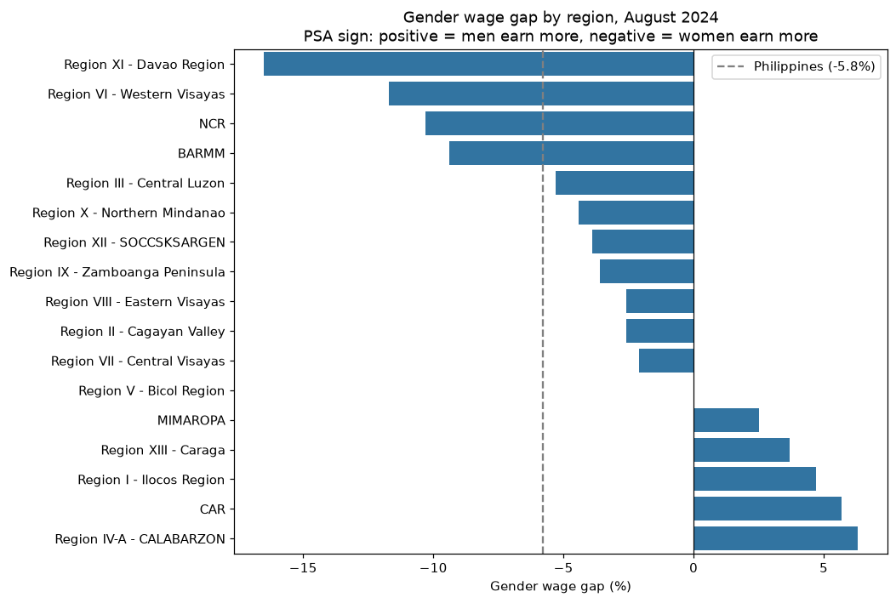

*Note.* Positive values mean men earn more. Bars left of zero mean women earn more, and the dashed line is the national value. Data from PSA (2025b).

Figure 1a is a diverging horizontal bar chart. Each bar is one region's gender wage gap, the difference between average male and female monthly wages as a percentage of the male wage. Bars extend left or right of zero depending on which sex earns more, and the regions are sorted by value. Among full-time time-rated workers, women earned 5.8% more than men nationally (PHP 22,236 against PHP 21,009 a month). The gap favored women in 11 of 17 regions, was zero in Bicol, and favored men in 5: CALABARZON (6.3%), CAR (5.7%), Ilocos (4.7%), Caraga (3.7%) and MIMAROPA (2.5%). The largest female advantages were in Davao Region (16.5%), Western Visayas (11.7%), NCR (10.3%) and BARMM (9.4%). However, the national figure is not simply the average of the regions. The simple mean of the 17 regional gaps is −2.9%, about half the national −5.8%, because the national value weights each worker equally and large labor markets such as NCR count for more.

Figure 1b shows the same data with the sign reversed and labelled as the female earnings advantage. PSA measures the gap with men as the reference, so a positive value means men earn more. In 11 of 17 regions the PSA value is negative, and a "negative gap" is easy to misread as a gap against women. Reversing the sign makes the most common case positive. The cost is that the numbers no longer match PSA's published table, so the text and tables in this report quote PSA's values and Figure 1b serves as a reading aid. Both figures hold the same 17 values with opposite signs.

**Figure 1b**

*Female Earnings Advantage by Region, August 2024*

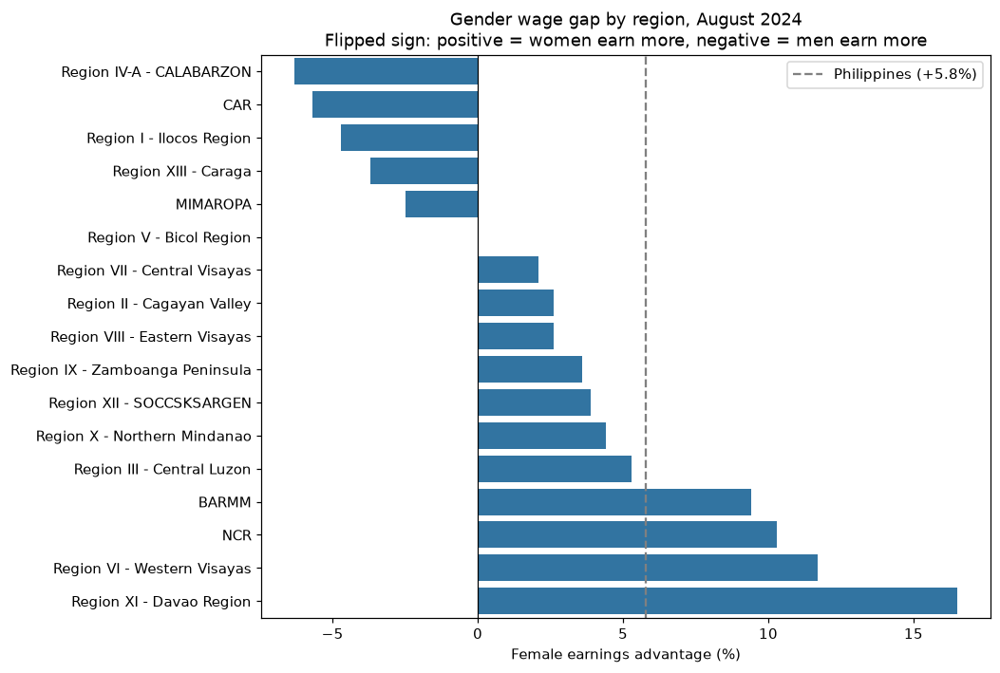

*Note.* The data of Figure 1a with the sign reversed: bars right of zero mean women earn more. The dashed line is the national value, +5.8%. Data from PSA (2025b).

### 3.2 Line charts: participation, labor force size, and school enrollment over time

**Figure 2**

*Labor Force Participation Rate by Sex, April 2005 to July 2026*

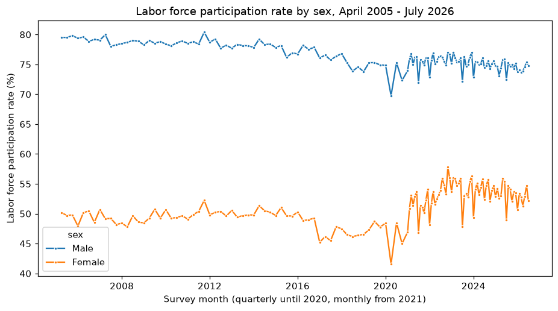

*Note.* Quarterly surveys until 2020, monthly from 2021. Data from PSA (2026b).

Figure 2 is a time-series line chart. Each point is one survey round's labor force participation rate (LFPR), the share of people aged 15 and over who are working or looking for work, plotted separately for men and women. Male participation fell from 79.5% in April 2005 to 74.8% in July 2026, while female participation rose from 50.2% to 52.2%. The gap was widest in January 2006 (31.4 points) and narrowest in November 2022 (19.2 points). The sharpest single drop is April 2020, during the first COVID-19 lockdown, when female participation fell to 41.5%.

**Figure 3**

*Persons in the Labor Force by Sex, April 2005 to July 2026*

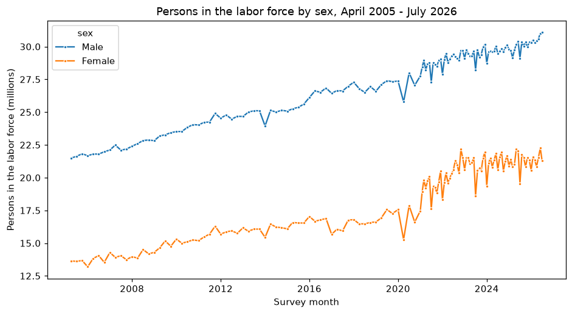

*Note.* Values are in millions of persons. Data from PSA (2026d).

Figure 3 uses the same kind of line chart but plots levels (numbers of people) in place of rates, so its lines combine population growth with changes in participation. In absolute numbers, the female labor force grew from 13.6 million to 21.3 million over the same period, and the male labor force from 21.5 million to 31.1 million. Section 3.5 shows how much of this growth reflects participation.

**Figure 4**

*Ratio of Girls to Boys Enrolled, SY 2008-09 to 2023-24*

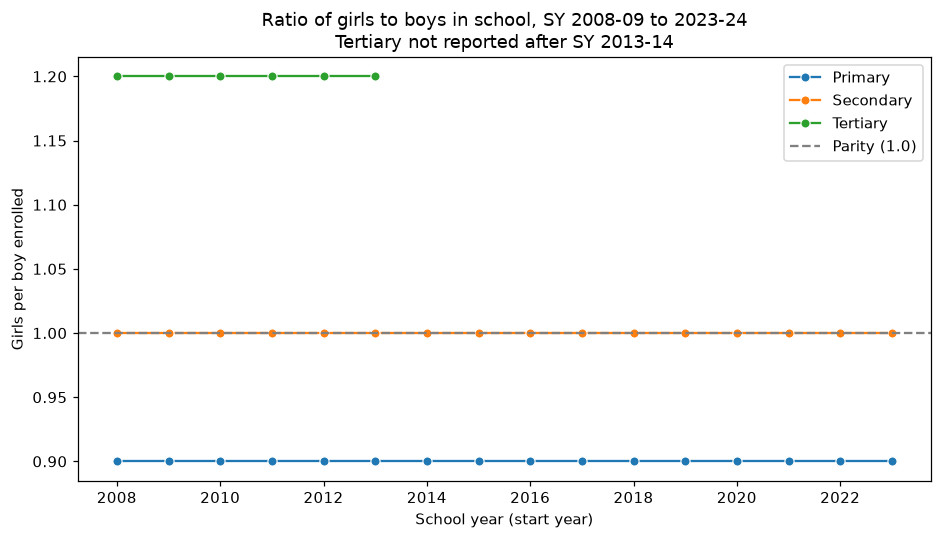

*Note.* Tertiary data stop after SY 2013-14. Data from PSA (2026a).

Figure 4 is a line chart of a parity ratio: girls enrolled divided by boys enrolled. The dashed reference line at 1.0 marks equal numbers. School enrollment, by comparison, barely moves. The published ratios are flat: 0.9 for primary, 1.0 for secondary, and 1.2 for tertiary while it was reported. These values are rounded to one decimal, so changes smaller than about 0.05 cannot be seen. The primary figure may also reflect the slightly larger number of boys in the school-age population rather than lower enrollment rates for girls; the table does not say whether it compares counts or rates.

### 3.3 Grouped bar chart: functional literacy by region and sex

**Figure 5**

*Functional Literacy Rate by Region and Sex, 2024 FLEMMS*

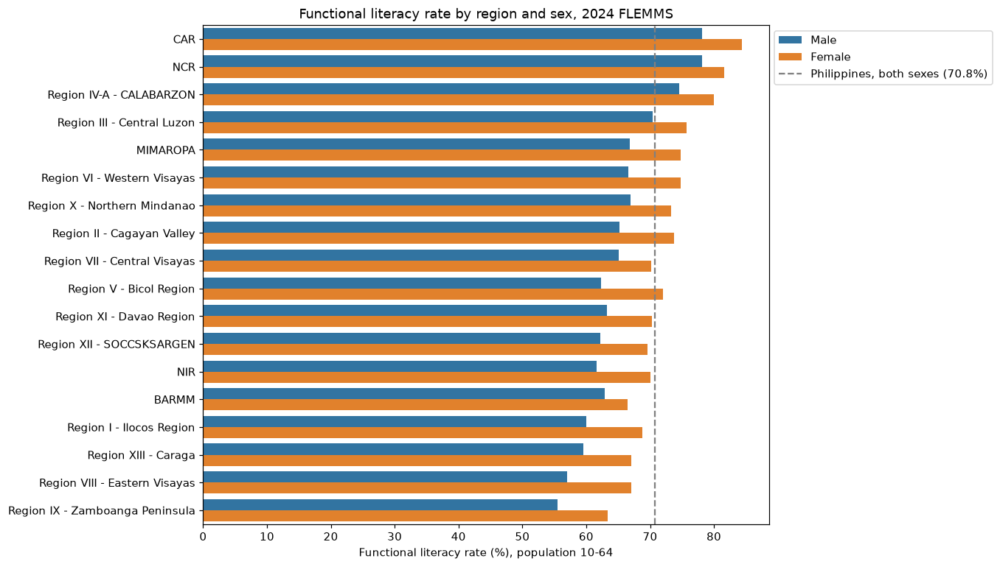

*Note.* Population aged 10 to 64. Data from PSA (2025a).

Figure 5 is a grouped bar chart. The male and female bars for each region sit side by side, so the sex gap within a region and the spread between regions can be read together. Functional literacy is PSA's measure of whether a person aged 10 to 64 can read, write, compute, and comprehend. In contrast to participation, women are more functionally literate than men in all 18 regions. Nationally the rates are 74.1% for women and 67.6% for men. The female lead ranges from 3.5 points in NCR to 10.0 points in Eastern Visayas. Regional differences are larger than the sex differences: CAR leads at 81.2% for both sexes combined, and Zamboanga Peninsula is lowest at 59.3%.

### 3.4 Dot plot on a log scale: the gender parity scorecard

**Figure 6**

*Gender Parity Scorecard: Female-to-Male Ratio by Indicator*

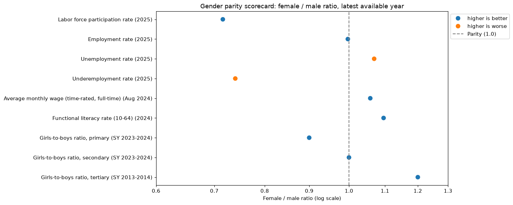

*Note.* Each indicator is shown at its latest available value. A ratio of 1.0 is parity. Data from PSA (2025a, 2025b, 2026a, 2026b).

Figure 6 is a dot plot of female-to-male ratios on a logarithmic axis. On a log scale a ratio and its inverse lie the same distance from parity, so 0.8 (women at 80% of the male value) sits as far from 1.0 as 1.25 does. To compare these results directly, the scorecard places all indicators on one scale. Women are ahead on functional literacy (1.10), wages of full-time wage earners (1.06), tertiary enrollment (1.20, in 2013-14), and underemployment (0.74, where lower is better). Employment rate (1.00) and secondary enrollment (1.00) are at parity. Women are behind on unemployment (1.07, where higher is worse), primary enrollment (0.90), and, by far the most, labor force participation (0.72).

### 3.5 Decomposition bar chart: why the labor force grew

**Figure 7**

*Shift-Share Decomposition of Labor Force Growth, 2006 to 2025*

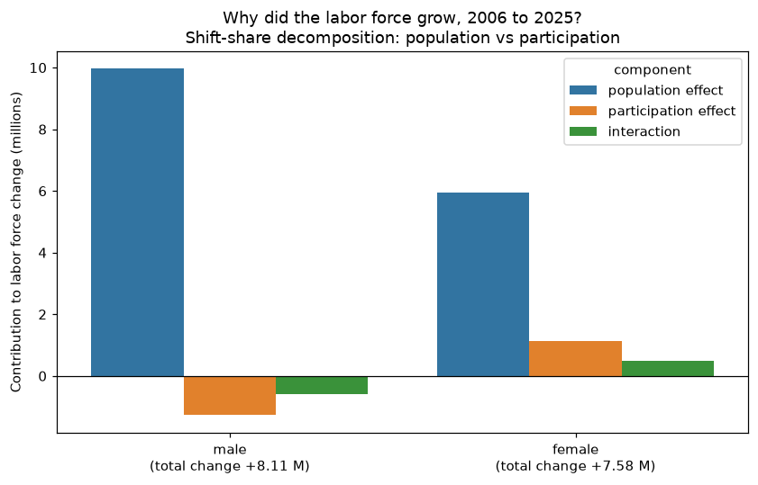

*Note.* The change in the labor force is split into population, participation, and interaction effects. Data from PSA (2026c).

Figure 7 shows a shift-share decomposition as a bar chart. Since the labor force equals population times the participation rate, its change splits exactly into three parts: a population effect (population change at the starting rate), a participation effect (rate change at the starting population) and an interaction term (the product of the two changes). Returning to labor force growth, the female labor force grew by 7.58 million between 2006 and 2025. Population growth accounts for 5.94 million (78%), higher participation for 1.14 million (15%), and the interaction of the two for 0.50 million (7%). For men, population growth added 9.96 million, more than the total increase of 8.11 million, because falling participation removed 1.27 million. The participation gap therefore narrowed from both sides.

### 3.6 Trend scatter with fitted lines: the participation gap is narrowing slowly

**Figure 8**

*Annual Gap in Labor Force Participation Rate, 2006 to 2025*

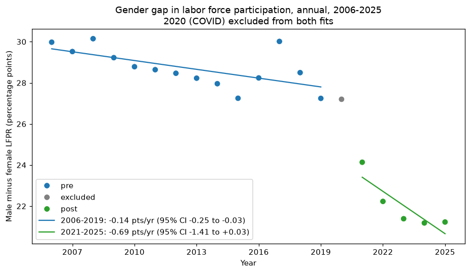

*Note.* Male minus female LFPR, with separate linear fits before and after COVID-19. Data from PSA (2026b).

Figure 8 combines a scatter plot of the annual gap with ordinary least squares (OLS) regression lines. The slope of each line is the average change in the gap per year, and its 95% confidence interval, based on the t distribution, gives the range of slopes consistent with the data. The year 2020 is left out of both fits.

| Period | Years | Slope (points per year) | 95% CI | Mean gap (points) |
| --- | --- | --- | --- | --- |
| 2006-2019 | 14 | −0.14 | −0.25 to −0.03 | 28.7 |
| 2021-2025 | 5 | −0.69 | −1.41 to +0.03 | 22.0 |

Before the pandemic the gap closed slowly but steadily; at that pace it would take about two centuries to close. After the pandemic, the gap has been about 6.7 points smaller on average. The post-2021 slope is steeper, but with five years its confidence interval includes zero. The year 2017 stands out with a gap of 30.0 points that these data do not explain.

### 3.7 Seasonal profile with range band: month-to-month movement

**Figure 9**

*Seasonal Pattern in Monthly Labor Force Participation, 2022 to 2025*

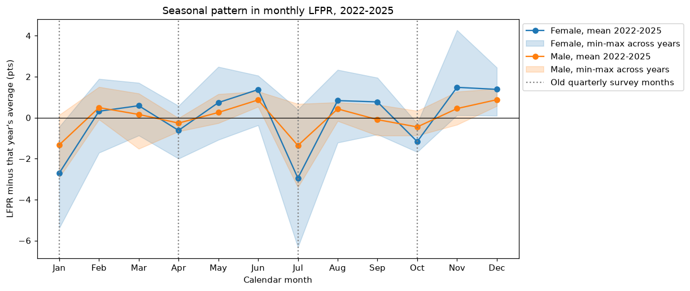

*Note.* Each month's LFPR minus that year's average. Dotted lines mark the four months surveyed before 2021. Data from PSA (2026b).

Figure 9 is a seasonal profile. Subtracting each year's average from its monthly values removes the trend, and averaging those deviations by calendar month shows the pattern that repeats each year. The shaded band is the range across the four years. Within each year, participation dips every January and July, and the dips are about twice as deep for women (−2.7 and −3.0 points on average) as for men (−1.3 and −1.4). Much of the noise in the monthly series after 2021 is this calendar pattern.

This pattern also raises a measurement question, which was explored outside the planned analysis: the four months surveyed before 2021 (January, April, July, and October) are all below their yearly averages. If the same pattern held before 2021, the old quarterly series would have shown the gap about 1.0 point wider than a full-year average. Up to one of the 6.7 points of narrowing after 2021 could therefore come from the change in survey design rather than a change in behavior.

### 3.8 Scatter plots: regional correlations

**Figure 10**

*Regional Correlations for the Three Pre-Specified Hypotheses*

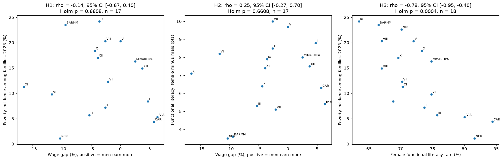

*Note.* Each panel reports the Spearman correlation, bootstrap confidence interval, and Holm-adjusted p-value. Data from PSA (2024, 2025a, 2025b).

Figure 10 uses scatter plots summarized by Spearman's rank correlation (rho), which measures whether two variables rise and fall together in rank order and is less affected by outliers than Pearson's r. The 95% confidence intervals come from a percentile bootstrap with 10,000 resamples of the regions. Because three hypotheses were tested at once, the p-values are adjusted with the Holm method.

| Hypothesis | Regions | Spearman rho | 95% CI | Holm-adjusted p |
| --- | --- | --- | --- | --- |
| H1: wage gap vs poverty incidence | 17 | −0.14 | −0.67 to +0.40 | 0.66 |
| H2: wage gap vs literacy gap (female minus male) | 17 | +0.25 | −0.27 to +0.70 | 0.66 |
| H3: female literacy vs poverty incidence | 18 | −0.78 | −0.95 to −0.40 | 0.0004 |

Across regions, places with higher female literacy have much lower poverty (H3). By contrast, the regional wage gap shows no clear relationship with either poverty or the literacy gap (H1 and H2). Regions with the largest female wage advantage include both the least poor region (NCR, 1.1% poverty incidence) and one of the poorest (BARMM, 23.5%). With 17 regions, only correlations of about 0.5 or stronger could be detected reliably, so weaker relationships cannot be ruled out.

## 4. Discussion

Filipino women are furthest behind men in labor force participation. On most education measures available here, women match or exceed men; primary enrollment (0.90) is the exception. Among those who hold full-time wage jobs, women earn more on average. Yet about 47% of women aged 15 and over were outside the labor force in 2025, against about 25% of men. These two findings, higher pay but lower participation, are probably connected. The wage table covers only time-rated, full-time employees, a group that excludes the self-employed, unpaid family workers, and part-time workers. If the women who enter full-time wage work are more educated on average than the men in the same jobs, the average female wage will be higher even where women as a whole are disadvantaged. This is a selection effect. The regional pattern fits the same reading: the female wage advantage is not tied to poverty or literacy, which suggests it depends on which jobs women hold in each region. Testing this needs wage data by occupation and education, or the LFS respondent files.

The participation gap is narrowing over time, but slowly, and part of the recent improvement is uncertain. The steady pre-2020 decline (0.14 points a year) came from falling male participation (79.3% in 2006 to 74.8% in 2019); female participation was lower in 2019 (47.6%) than in 2006 (49.3%). The larger step after 2021 coincides with the switch to a monthly survey, and the seasonal analysis suggests that up to about 1 of the 6.7 points could be a measurement effect. The rest may be real, but five years of data cannot yet show whether the faster decline will last. Finally, the regional results describe regions, not people. The strong link between female literacy and poverty (rho = −0.78) does not show that an individual poor woman is less literate, an error known as the ecological fallacy. It also does not show which causes which: urbanization, school access, and conflict history could drive both.

## 5. Limitations

The first set of limits comes from the published tables themselves. Most of them report no standard errors, so differences between regions or between sexes cannot be tested statistically; the poverty table is the only exception. The indicators also come from different surveys and years (wages and literacy in 2024, poverty in 2023, enrollment up to SY 2023-24, and labor up to 2026), which means the scorecard sets side by side snapshots taken at different times. The wage gap is unadjusted as well. It compares the average wages of full-time, time-rated employees without holding occupation, hours, education, or experience constant. For enrollment, the ratios are rounded to one decimal, the tertiary series stops in SY 2013-14, and the table does not say whether it compares head counts or enrollment rates. In addition, the Labor Force Survey moved from quarterly to monthly rounds in 2021, so the series before and after that year may not be fully comparable.

The statistical methods add limits of their own, meaning that each regional analysis rests on only 17 or 18 points, which is enough to detect strong correlations but can miss weaker ones. Similarly, the trend confidence intervals assume that each year's deviation from the fitted line is independent of the year before. Labor market data are usually autocorrelated, so the true uncertainty around the slopes is probably somewhat larger than the intervals show.

## 6. Conclusion and recommendations

Public PSA data show a gender gap in the Philippines that runs in two directions. Women are ahead of men in functional literacy, in tertiary enrollment where it was last reported, and in the average wage of full-time wage employees. They are far behind in labor force participation, with a female-to-male ratio of 0.72 in 2025. That gap narrowed slowly before 2020 because fewer men participated, and has been smaller since 2021, though part of the recent change may reflect the new monthly survey. For policy, then, the evidence points to participation as the dimension with the most room to move. Raising female participation from 53% toward the male rate would affect millions of women, while most education and wage indicators are already at or above parity.

Beyond this report, three steps would sharpen these conclusions:

1. Use LFS respondent files to study why women stay outside the labor force (care work, household duties, job availability) and to compute an adjusted wage gap by occupation and education.
2. Check PSA's LFS technical notes on how the January, April, July, and October rounds differ from other months, to separate seasonal effects from survey design.
3. Request standard errors for the regional tables so regional differences can be tested, and map the results to regional boundaries for a geographic view.

## References

Albert, J. R. G., & Vizmanos, J. F. V. (2017). *Do men and women in the Philippines have equal economic opportunities?* (PIDS Policy Notes No. 2017-09). Philippine Institute for Development Studies. <https://pidswebs.pids.gov.ph/CDN/NEWS/pidspn1709.pdf>

Conchada, M. I. P., Sy, D. H. A., Tiongco, M. M., & Paloyo, A. R. (2019). Recent trends in the gender gap in the labor market in the Philippines. *The Philippine Review of Economics, 56*(1–2). <https://pre.econ.upd.edu.ph/index.php/pre/article/view/984>

David, C. C., Albert, J. R. G., & Vizmanos, J. F. V. (2019). *Boys are still left behind in basic education* (PIDS Policy Notes No. 2018-20). Philippine Institute for Development Studies. <https://doi.org/10.62986/pn2018.20>

Efron, B. (1979). Bootstrap methods: Another look at the jackknife. *The Annals of Statistics, 7*(1), 1–26. <https://doi.org/10.1214/aos/1176344552>

Holm, S. (1979). A simple sequentially rejective multiple test procedure. *Scandinavian Journal of Statistics, 6*(2), 65–70.

Philippine Institute for Development Studies. (2026, May 6). *PH heading toward care crisis as demand rises: PIDS study* [Press release]. <https://pids.gov.ph/details/news/press-releases/ph-heading-toward-care-crisis-as-demand-rises-pids-study>

Philippine Statistics Authority. (2024, August 15). *Table 1. Annual per capita poverty threshold and poverty incidence among families with measures of precision, by region and province: 2018, 2021, and 2023* [Data set]. <https://openstat.psa.gov.ph/PXWeb/pxweb/en/DB/DB__1F__FY/0011F3DF010.px>

Philippine Statistics Authority. (2025a, May 23). *2024 Functional Literacy, Education and Mass Media Survey (FLEMMS): Statistical tables, final results* [Data set]. <https://psa.gov.ph/statistics/education-mass-media/node/1684076281>

Philippine Statistics Authority. (2025b, November 24). *Table 4. Gender wage gap and average monthly wage rates of time-rated workers on full-time basis by sex and region, Philippines: August 2024* [Data set]. <https://psa.gov.ph/node/1684081189>

Philippine Statistics Authority. (2026a, March 12). *Table 10.1b. Ratio of girls to boys in primary, secondary and tertiary education: SY 2008-2009 to SY 2023-2024* [Data set]. <https://openstat.psa.gov.ph/PXWeb/pxweb/en/DB/DB__3S__C10/0023E2BRGB0.px/?rxid=21e9828f-e1d4-42c6-ba60-c59ef3f59488>

Philippine Statistics Authority. (2026b, September 7). *Rates of key employment indicators: April 2005 to July 2026* [Data set]. PSA OpenSTAT. <https://openstat.psa.gov.ph/PXWeb/pxweb/en/DB/DB__1B__LFS/0021B3FKEI2.px/?rxid=900f32e5-4e65-4dd7-8ae5-bb04a29ec5bb>

Philippine Statistics Authority. (2026c, September 29). *Levels of key employment indicators: April 2005 to July 2026* [Data set]. PSA OpenSTAT. <https://openstat.psa.gov.ph/PXWeb/pxweb/en/DB/DB__1B__LFS/0011B3FKEI1.px/?rxid=900f32e5-4e65-4dd7-8ae5-bb04a29ec5bb>

Philippine Statistics Authority. (2026d, September 30). *Persons in the labor force by sex and by age group: April 2005 to July 2026* [Data set]. PSA OpenSTAT. <https://openstat.psa.gov.ph/PXWeb/pxweb/en/DB/DB__1B__LFS/0041B3FKEI4.px/?rxid=900f32e5-4e65-4dd7-8ae5-bb04a29ec5bb>

Spearman, C. (1904). The proof and measurement of association between two things. *The American Journal of Psychology, 15*(1), 72–101. <https://doi.org/10.2307/1412159>

United Nations. (n.d.). *Goal 5: Achieve gender equality and empower all women and girls*. <https://sdgs.un.org/goals/goal5>

United Nations Development Programme. (2025). *Human development report 2025: Statistical annex, Table 4. Gender Development Index* [Data set]. <https://hdr.undp.org/sites/default/files/2025_HDR/HDR25_Statistical_Annex_GDI_Table.pdf>

Wickham, H. (2014). Tidy data. *Journal of Statistical Software, 59*(10), 1–23. <https://doi.org/10.18637/jss.v059.i10>

World Bank. (2026). *Labor force participation rate, female (% of female population ages 15+) (modeled ILO estimate)* [Data set]. World Development Indicators. Retrieved October 27, 2026, from <https://data.worldbank.org/indicator/SL.TLF.CACT.FE.ZS?locations=PH>

World Economic Forum. (2025). *Global gender gap report 2025*. <https://www3.weforum.org/docs/WEF_GGGR_2025.pdf>
